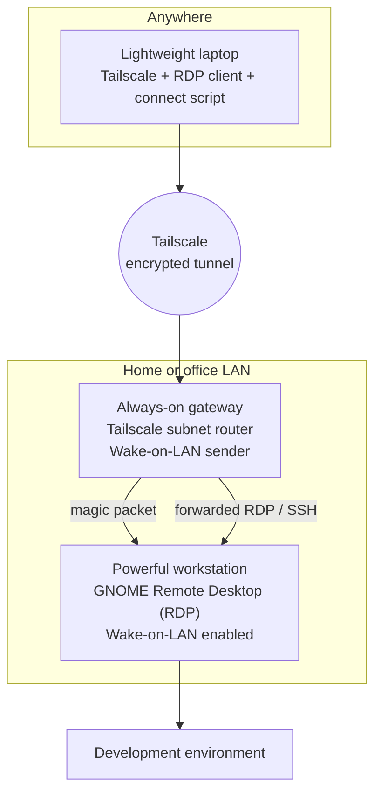

# Remote Workstation Anywhere

> Want to work on your powerful machine from anywhere, using almost any computer?

Keep a fast desktop at home or in the office, carry a light laptop, and reach the desktop's full development environment over an encrypted private network. The desktop does not have to stay on: a tiny always-on device (for example a Raspberry Pi) wakes it on demand with Wake-on-LAN.

This is a **documentation and automation** repository. It does not introduce a new remote desktop application. It wires together mature tools (Tailscale, GNOME Remote Desktop, FreeRDP, Wake-on-LAN) and provides small, readable scripts so that one command does everything.

## The problem

A laptop that matches a high-end desktop costs a lot, runs hot, and ages quickly. Leaving the desktop running 24/7 wastes power. Exposing it to the internet is dangerous.

## How it works



1. Your laptop joins your private Tailscale network.
2. The gateway advertises your LAN as a Tailscale *subnet route*, so the laptop can reach LAN addresses without any router port forwarding.
3. If the workstation is asleep or off, the connect script asks the gateway (over SSH) to send a Wake-on-LAN magic packet.
4. Once the workstation's RDP port answers, the script fetches your password from the OS credential store and starts FreeRDP, fullscreen, with dynamic resolution and optional HiDPI scaling.

More detail, including a sequence diagram: [docs/architecture.md](docs/architecture.md).

## Features

- No inbound ports opened on your router, no public exposure of RDP or SSH.
- Remote power-on from suspend **and** from full shutdown (hardware permitting).
- One command: check, wake if needed, wait, authenticate, connect.
- Passwords come from the OS credential store and are passed to FreeRDP on stdin, never as a command-line argument.
- Plain Bash scripts, no dependencies beyond the tools you already need.
- All machine-specific values live in one config file that is never committed.
- Honest status labels: verified, documented-but-untested, experimental.

## What has actually been tested

| Role | Tested configuration | Status |
|---|---|---|
| Workstation | Ubuntu 26.04, GNOME, Wayland, GNOME Remote Desktop "Remote Login" (RDP) | **Verified** |
| Wake-on-LAN | From suspend and from full shutdown, via `ethtool` + NetworkManager | **Verified** |
| Gateway | Raspberry Pi 5, Ubuntu Server, Ethernet, Tailscale subnet router | **Verified** |
| Client | macOS, Tailscale, FreeRDP (`sdl-freerdp`), Keychain | **Verified** |
| Client | Linux with FreeRDP 3 and libsecret | Experimental (script written, not run on real hardware) |
| Client | Windows with the built-in Remote Desktop client | Untested (documented procedure only) |
| Workstation | KDE, XRDP, Windows host, other distros | Untested |
| Gateway | Any other always-on Linux device | Expected to work, untested |

Details and caveats: [docs/prerequisites.md](docs/prerequisites.md).

## Prerequisites

- A workstation with wired Ethernet and firmware that supports Wake-on-LAN.
- An always-on Linux device on the same LAN (wired recommended).
- A free [Tailscale](https://tailscale.com/) account.
- A client computer with Tailscale and an RDP client (FreeRDP recommended).
- A router that can reserve a DHCP address for the workstation.

## Quick start

All addresses below are examples. Substitute your own.

**1. Workstation** (see [docs/ubuntu-gnome.md](docs/ubuntu-gnome.md) and [docs/wake-on-lan.md](docs/wake-on-lan.md))

```bash
# Settings > System > Remote Desktop > Remote Login: enable it, then:
sudo grdctl --system rdp set-credentials          # prompts; password stays out of history
sudo grdctl --system rdp set-auth-methods credentials
sudo systemctl restart gnome-remote-desktop.service

# Wake-on-LAN (find your interface and profile names with `ip -br link` and `nmcli connection show`)
sudo nmcli connection modify "<profile>" 802-3-ethernet.wake-on-lan magic
```

**2. Gateway** (see [docs/tailscale-setup.md](docs/tailscale-setup.md))

```bash
sudo apt install wakeonlan
sudo tailscale up --advertise-routes=192.168.1.0/24
# then approve the route in the Tailscale admin console
```

**3. Client, macOS example** (see [docs/macos-client.md](docs/macos-client.md))

```bash
brew install freerdp
security add-generic-password -U -a youruser -s remote-workstation -w   # prompts for the RDP password

git clone https://github.com/<you>/remote-workstation-anywhere.git
cd remote-workstation-anywhere
mkdir -p ~/.config/remote-workstation-anywhere ~/bin
cp examples/config.example.env ~/.config/remote-workstation-anywhere/config.env
chmod 600 ~/.config/remote-workstation-anywhere/config.env
${EDITOR:-nano} ~/.config/remote-workstation-anywhere/config.env
ln -s "$PWD/scripts/macos/connect.sh" ~/bin/remote-workstation

remote-workstation --check    # validates config, client, credential, reachability
remote-workstation            # the one command
```

## Documentation

| Topic | Guide |
|---|---|
| Architecture and diagrams | [docs/architecture.md](docs/architecture.md) |
| Prerequisites and support matrix | [docs/prerequisites.md](docs/prerequisites.md) |
| LAN, DHCP reservations, addressing | [docs/network-setup.md](docs/network-setup.md) |
| Tailscale and the gateway | [docs/tailscale-setup.md](docs/tailscale-setup.md) |
| Wake-on-LAN | [docs/wake-on-lan.md](docs/wake-on-lan.md) |
| Ubuntu / GNOME workstation | [docs/ubuntu-gnome.md](docs/ubuntu-gnome.md) |
| macOS client | [docs/macos-client.md](docs/macos-client.md) |
| Linux client (experimental) | [docs/linux-client.md](docs/linux-client.md) |
| Windows client (untested) | [docs/windows-client.md](docs/windows-client.md) |
| Security | [docs/security.md](docs/security.md) |
| Troubleshooting | [docs/troubleshooting.md](docs/troubleshooting.md) |
| FAQ | [docs/faq.md](docs/faq.md) |
| Validation checklist | [docs/validation-checklist.md](docs/validation-checklist.md) |
| Roadmap | [docs/roadmap.md](docs/roadmap.md) |
| End-to-end tested setup walkthrough | [docs/remote-development-workstation-guide.md](docs/remote-development-workstation-guide.md) |
| Gateway Pi: read-only root with RAM OverlayFS | [docs/raspberry-pi-read-only-overlayfs-guide.md](docs/raspberry-pi-read-only-overlayfs-guide.md) |
| Gateway Pi: full-disk backup and recovery | [docs/raspberry-pi-backup-and-recovery-guide.md](docs/raspberry-pi-backup-and-recovery-guide.md) |

## Security considerations

- Never port-forward RDP or SSH. Tailscale is the only way in.
- Joining the tailnet is not the same as being authorized for RDP. Use Tailscale access policies and keep a strong RDP password.
- A subnet route makes the whole advertised LAN reachable. Advertise as little as you can and restrict who may use it.
- Restricting SSH to the gateway does **not** restrict RDP to the workstation. They are separate destinations.
- Do not disable screen locking or authentication to make remote access easier.

Read [docs/security.md](docs/security.md) and finish its checklist after installation.

## Limitations

- Wake-on-LAN depends on firmware, NIC, power and cable. It is not universal. Wired Ethernet is effectively required.
- Remote wake needs an always-on device on the workstation's LAN.
- Performance depends on latency and bandwidth. GPU-heavy or latency-sensitive applications may behave differently over RDP.
- GNOME Remote Login may give you a session separate from the one on the physical screen.
- A reachable RDP port does not prove that RDP login will succeed.

## Troubleshooting

Start at [docs/troubleshooting.md](docs/troubleshooting.md). It covers the failures we hit while building this: RDP port open but login failing, `Credentials are not set`, a client that fails while FreeRDP works, tiny HiDPI display, wake from suspend but not shutdown, and script problems.

## Contributing

Issues and pull requests are welcome, especially test reports for platforms marked untested. See [CONTRIBUTING.md](CONTRIBUTING.md). Never include real addresses, MACs, hostnames, usernames or credentials in issues or PRs.

## License

[MIT](LICENSE)
