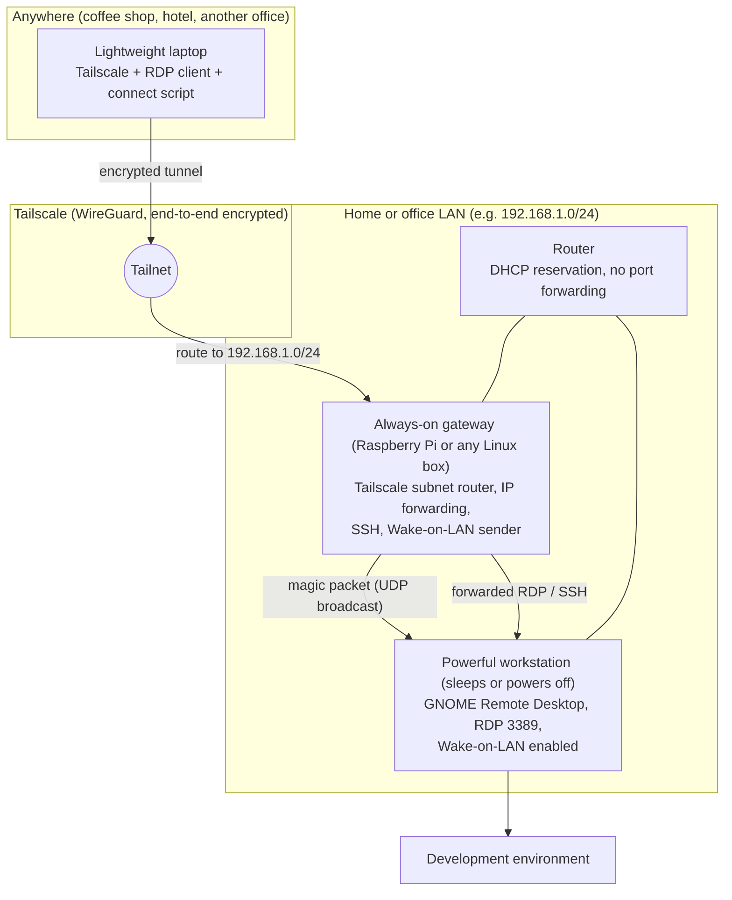
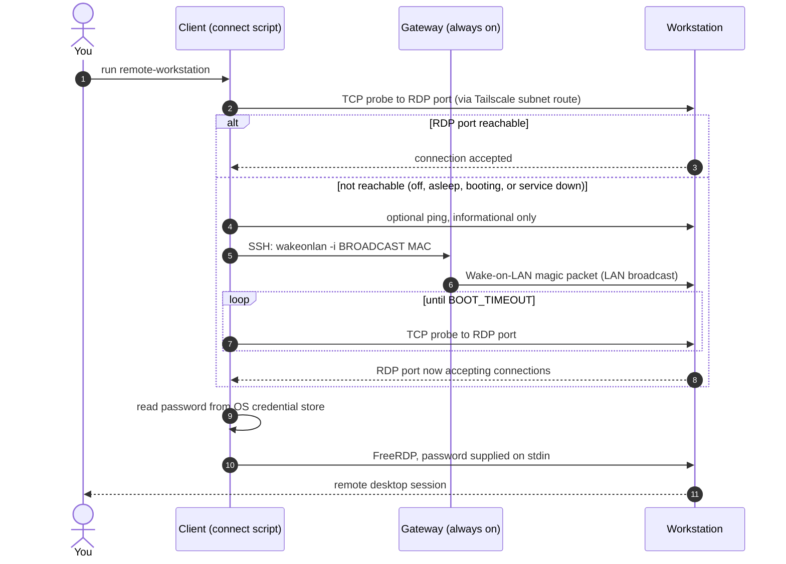

# Architecture

## Communication flow

```text
Remote Laptop
    |
    | Encrypted Tailscale connection
    v
Always-on Gateway
    |
    | Tailscale subnet routing
    | Wake-on-LAN
    v
Powerful Workstation
    |
    | RDP / SSH
    v
Development Environment
```

The same flow as a diagram (source: [`assets/architecture.mmd`](../assets/architecture.mmd)):



## Connection sequence

Source: [`assets/sequence.mmd`](../assets/sequence.mmd).



## Why the packet is sent *from the gateway*

A Wake-on-LAN magic packet is a Layer-2 broadcast on the workstation's own LAN segment. Tailscale subnet routing carries routed IP traffic, not LAN broadcasts, so a packet sent from your laptop would never reach the sleeping machine. The gateway sits on that segment, so the client simply asks the gateway (over SSH) to send it locally.

## Components and what they are *not*

These four things are often confused.

| Component | What it does here | What it is **not** |
|---|---|---|
| **Tailscale subnet router** (the gateway) | Joins the tailnet and advertises a LAN prefix. Forwards packets between tailnet devices and LAN devices. | Not an RDP proxy. It does not terminate or inspect RDP. The client still connects directly to the workstation's LAN address. |
| **RD Gateway** (Microsoft Remote Desktop Gateway) | A Windows Server role that tunnels RDP over HTTPS to internal hosts. | Not used here. Leave any "RD Gateway" field in RDP clients **unset**. |
| **Local router** | Provides DHCP (including reservations), NAT and the default route for the LAN. | Not involved in remote access. No port forwarding is configured on it. |
| **DNS server** | Resolves names to addresses. | Not required. This setup uses IP addresses. MagicDNS or local DNS can give friendly names but nothing here depends on them. |

## Roles of each machine

- **Client**: runs Tailscale, an RDP client and the connect script. Holds the credential in the OS credential store.
- **Gateway**: always on, wired, runs Tailscale as a subnet router with IP forwarding, has SSH (key auth) and a Wake-on-LAN utility. Any suitable always-on Linux device works; a Raspberry Pi is convenient, not required.
- **Workstation**: Wake-on-LAN enabled in firmware and OS, DHCP reservation, GNOME Remote Desktop in Remote Login mode.

## Traffic paths

| Step | Path |
|---|---|
| SSH to gateway | client → tailnet → gateway |
| Wake-on-LAN | client → (SSH) → gateway → LAN broadcast → workstation NIC |
| RDP | client → tailnet → gateway (forwarding) → workstation:3389 |

By default a Tailscale subnet router masquerades (source-NATs) forwarded traffic, so the workstation sees RDP connections coming from the **gateway's LAN address**, not from the laptop's Tailscale address. See [security.md](security.md) for what that means for firewall rules and logging.

## What can fail where

| Layer | Typical failure | See |
|---|---|---|
| Client ↔ tailnet | Tailscale not connected, route not accepted | [tailscale-setup.md](tailscale-setup.md) |
| Client ↔ gateway | SSH key or alias wrong | [troubleshooting.md](troubleshooting.md) |
| Gateway ↔ workstation | Wrong MAC or broadcast, NIC not armed for WoL | [wake-on-lan.md](wake-on-lan.md) |
| Workstation service | RDP service up but credentials unset | [ubuntu-gnome.md](ubuntu-gnome.md) |
| Client app | RDP client incompatibility | [macos-client.md](macos-client.md) |
